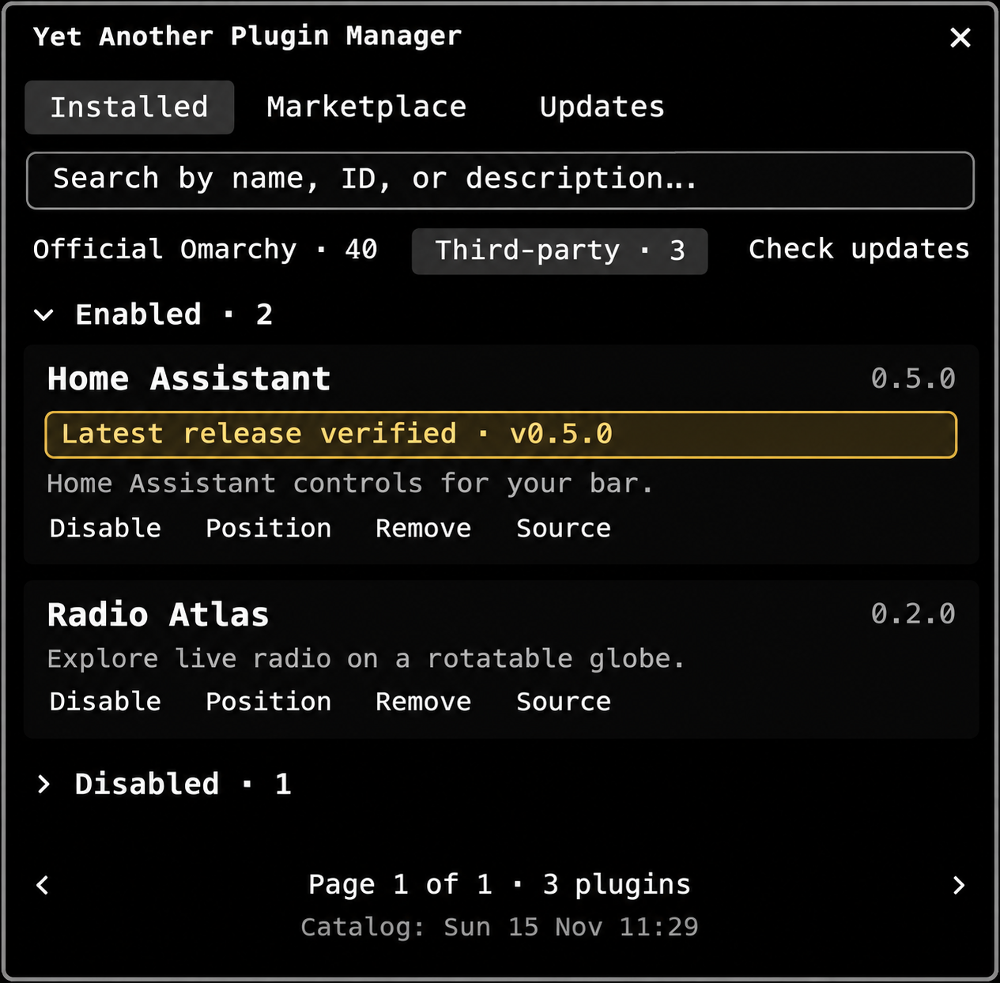

# Yet Another Plugin Manager

**YAPM** is a compact plugin manager for the Omarchy shell. Discover community
plugins, manage what is installed, and check for updates without leaving your bar.



## Features

- **Manage installed plugins:** enable, disable, and remove plugins from one panel.
- **Keep things organized:** separate Official Omarchy and Third-party categories,
  each with expandable Enabled and Disabled sections.
- **Arrange your bar:** use each installed bar widget’s **Position** button to
  choose Left, Before center, Center, After center, Right, or Tray. For disabled
  widgets, **Enable here** enables them in the selected section.
- **Find plugins:** search names, IDs, descriptions, and marketplace authors.
- **Browse the marketplace:** discover plugins from [plugins.omarchy.org](https://plugins.omarchy.org/)
  and install supported plugin repositories.
- **Choose how installs behave:** keep new plugins disabled, or switch on
  **Enable after installation**. Your preference is remembered.
- **Check updates directly:** compare installed plugins with their Git repositories
  without downloading the marketplace catalog.
- **Protect required components:** plugins Omarchy marks non-disableable show
  **Required** instead of a Disable button.
- **Keep downloads small:** compressed catalog downloads, a gzip cache, and
  conditional requests avoid downloading an unchanged catalog again.

## Requirements

- Omarchy Quattro with its running shell and `omarchy` plugin commands.
- Python 3, Git, and Curl. No additional Python packages are required.

## Installation

```sh
omarchy plugin add https://github.com/Z1Z0R/YAPM.git --enable
```

To install from a local copy instead:

```sh
git clone https://github.com/Z1Z0R/YAPM.git
cd YAPM
./install.sh
```

The local installer backs up your shell configuration and refuses to overwrite
an existing YAPM installation. Both methods install under
`~/.config/omarchy/plugins/yapm`.

## Usage

Click the **cube icon** on the right side of the bar to open YAPM.

| Tab | What you can do |
| --- | --- |
| Installed | Choose Official Omarchy or Third-party, expand Enabled or Disabled, and manage plugins. |
| Marketplace | Refresh the catalog, search plugins, review their source, and install them. |
| Updates | Check installed Git repositories and choose individual plugins to update. |

Use the search field to filter the current view. Click **Clear** to reset it.
Press **Escape** to close the panel; use **Tab** to move between controls.

Network checks are manual. Cached marketplace browsing and installed-plugin
controls work offline. YAPM does not schedule installations or updates.

### About plugins and updates

Plugins run with your user account's access inside the Omarchy shell. Review
sources before installing or enabling them. Use plugins, install them, and
apply updates at your own discretion.

Updates fetch the latest **default-branch commit from the installed repository**,
which may be newer than a published release or the marketplace version. YAPM
uses Omarchy's fast-forward update and validation commands; local edits block
updates. Review upstream changes before updating.

Update checks support installed HTTPS Git repositories, including plugins that
are not listed in the marketplace. Built-in plugins are updated through Omarchy.
Local plugins without a Git checkout and SSH origins cannot be updated here.
Marketplace entries requiring manual setup are shown but cannot be installed
through YAPM.

### Configuration and data

- **Plugin files:** `~/.config/omarchy/plugins/yapm/`
- **Preferences:** YAPM's entry in `~/.config/omarchy/shell.json`
- **Catalog and operation cache:** `${XDG_CACHE_HOME:-~/.cache}/yapm/`

The marketplace catalog is cached as `catalog.json.gz`. Downloads and cache
decompression have a **64 MiB decoded size limit**. Short descriptions come
from installed plugin manifests, with cached marketplace descriptions as a fallback.

### Command-line shortcuts

```sh
omarchy-shell shell summon yapm '{}'
omarchy-shell yapm page marketplace
omarchy-shell yapm page updates
omarchy-shell shell hide yapm
```

To remove YAPM:

```sh
omarchy plugin remove yapm
```

## Development

```sh
python3 -m unittest discover -s tests -v
omarchy plugin validate .
```

See [development notes](docs/development.md) for QML validation and runtime details.

## License

[MIT](LICENSE) · Copyright © 2026 Zizor.
